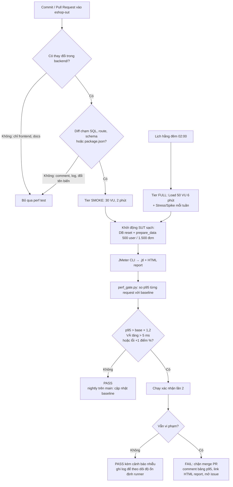
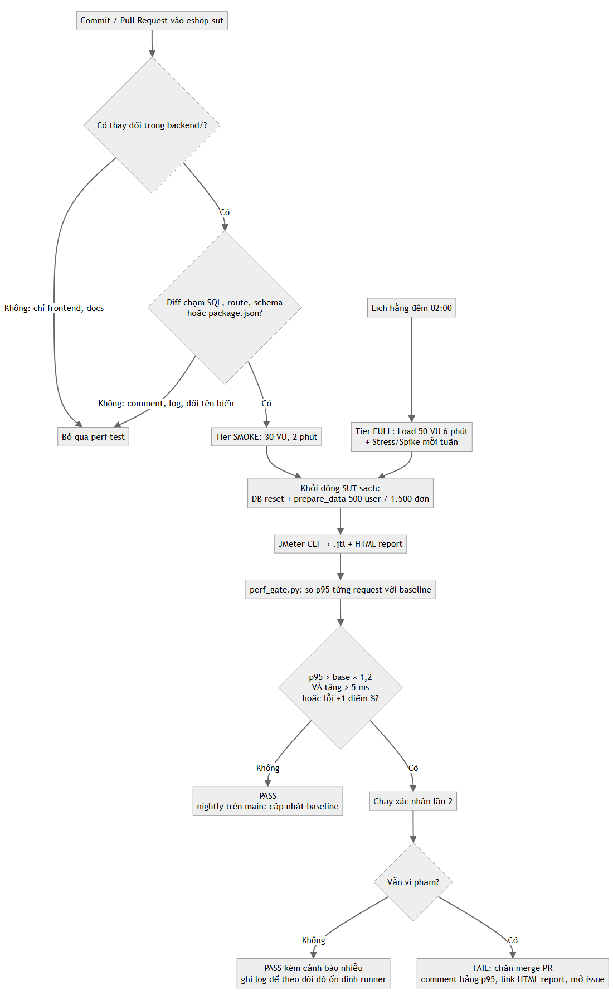
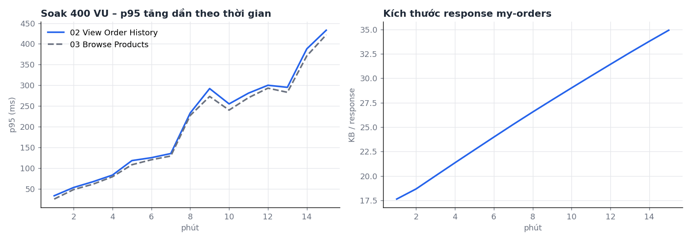

# HW05 – Performance Testing – Báo cáo chính (Thành viên 5 – 23120317)

> File ghép tự động từ README và các tài liệu trong `docs/` bằng `scripts/build_pdf.py`. Phụ lục AI: Appendix A `docs/prompt_log.md`, AI Audit Report, Disclosure Form, Reflective Statement, Privacy Checklist (`pdf/`, `ai-forms/`).

# HW05 – Performance Testing – Thành viên 5

**Nguyễn Đức Phát – MSSV 23120317**
**Workflow 5:** Login → View Order History → Browse Products → Add to Cart → Checkout (truy xuất lịch sử đơn hàng và tạo đơn mới)
**Công cụ:** Apache JMeter 5.6.3 · Node.js 22 · SUT: [eshop-sut](https://github.com/ttbhanh/eshop-sut)
**Video demo (Unlisted):** https://youtu.be/Y2VKcs27d3Y
**GitHub:** repo nhóm https://github.com/KTPM2026/HW5 (PR #1, Issues #2–#7) · bản public đầy đủ trên fork: https://github.com/hcmus-phat/HW5/tree/member5-23120317/member5_23120317

## Test summary report

| Hạng mục | Kết quả |
|---|---|
| Kịch bản đã chạy | Load (50 VU), Stress (100→500 VU), Spike (20→320 VU) – chính thức 22/11/2026, có video. Stress breakpoint (400→2000 VU) và Soak 15 phút – khảo sát 19/11/2026 |
| Nhóm endpoint | Auth-heavy: `POST /api/login` · Read-heavy: `GET /api/orders/my-orders`, `/api/products`, `/api/products?search=`, `/api/products/:id` · Transactional: `POST/GET /api/cart`, `POST /api/checkout` |
| Dữ liệu | CSV 500 tài khoản + 1.500 đơn lịch sử (`data/`), sinh bằng `scripts/prepare_data.js` |
| Load | 8.268 request, 23,2 RPS, p95 5 ms, 0% lỗi |
| Stress | 193.203 request, đỉnh ~735 RPS, p95 45 ms (bậc 500 VU: 80–90 ms), 0% lỗi |
| Spike | 13 → ~202 → 13 RPS, p95 6–7 ms, 0% lỗi, hồi phục ngay |
| **Ngưỡng chịu tải** | Throughput tối đa **~900–950 RPS** (SLA p95 ≤ 500 ms tới ~400 VU); bão hòa từ 800 VU; **gãy ở ~1.100–1.200 VU** (connection refused) |
| **Ngưỡng bền (soak 15 phút)** | **~540 RPS**, 0% lỗi, p95 tổng 244 ms nhưng trôi 47 → 393 ms; RAM node tối đa **127 MB** (đỉnh tuyệt đối 188 MB khi quá tải) |
| Bug / performance issue | 6 (xem `docs/05_GitHub_Issues.md` và GitHub Issues) |

## Cấu trúc

| Thư mục / file | Nội dung |
|---|---|
| `docs/01_API_Survey.md` | Khảo sát API Login, Order History, Products, Cart, Checkout |
| `docs/02_Test_Design.md` | Thiết kế 3 kịch bản, tham số, SLA, xử lý lockout |
| `docs/03_Results_Analysis.md` | Kết quả, nguyên nhân gốc, đề xuất tối ưu (đã kiểm chứng) |
| `docs/task2/` | Task 2: prompt, output AI nguyên văn, review diễn giải sai |
| `docs/05_GitHub_Issues.md` | Nội dung 6 issue ([GitHub Issues #2–#7](https://github.com/KTPM2026/HW5/issues)) |
| `docs/06_Task3_Continuous_Performance_Testing.md` | Task 3: lưu đồ, cổng hồi quy p95, đánh đổi chi phí / báo động giả |
| `ci/` | `perf-regression.yml` (GitHub Actions mẫu), `baseline.json` |
| `skill/perf-testing-workflow/SKILL.md` | Agent Skill tái sử dụng quy trình cho nhóm endpoint khác |
| `docs/07_AI_Audit_Report.md` | AI Audit Report theo mẫu [AI-02] (15 artifact, verdict VALID/INVALID/INCOMPLETE) |
| `docs/09_AI_Disclosure_Form.md` | AI Use Disclosure Form [AI-03] |
| `docs/10_AI_Reflective_Statement.md` | Reflective AI Use Statement [AI-04] |
| `docs/11_AI_Privacy_Checklist.md` | Privacy & Responsible AI Use Checklist [AI-05] |
| `docs/prompt_log.md` | Appendix A – prompt log có thời gian |
| `ai-forms/` | Bản .docx điền trên template gốc [AI-02]…[AI-05] (cần ký) |
| `docs/08_AI_Critique.md` | AI Critique (200–300 từ) |
| `docs/ai_session_transcript.txt` | Transcript đầy đủ phiên Claude Code (`/export`) |
| `pdf/` | PDF: báo cáo chính, AI Critique, AI Audit Report, Disclosure, Reflective, Privacy, Prompt log |
| `test-plans/` | `23120317_{Load,Stress,Spike,Soak}_20261119.jmx` |
| `data/` | `users.csv`, `products.csv` |
| `results/<plan>/` | `.jtl`, `html-report/`, `node_resource.csv`, `analysis.md` |
| `evidence/` | dxdiag, ảnh tool + Task Manager, ảnh 3 report view, `github_issues/` (ảnh trang Issues), biểu đồ issue |
| `scripts/` | Sinh test plan, chuẩn bị dữ liệu, reset lockout, chạy, phân tích, đo index, cổng hồi quy `perf_gate.py`, vẽ biểu đồ |

> Hai file `.jtl` > 50 MB (Soak, Stress breakpoint) không đưa lên GitHub. Chúng được nén nộp kèm trên Moodle.

## Self-assessment

> Agent Skill: đã có `skill/perf-testing-workflow/SKILL.md` nhưng chưa có video demo dùng skill trên một nhóm endpoint hoàn chỉnh như đề yêu cầu → tự chấm 0.

| No. | Criteria | Grade | Self-assessed |
|---|---|---:|---:|
| 1 | Task 1 – Load testing | 30 | 30 |
| 2 | Task 1 – Stress testing | 20 | 20 |
| 3 | Task 1 – Spike testing | 20 | 20 |
| 4 | Task 2 – AI analysis + misinterpretation hunt | 10 | 10 |
| 5 | Task 3 – Continuous Performance Testing proposal | 10 | 10 |
| 6 | Agent Skills | 10 | 0 |
| | **Total** | **100** | **90** |


<div class="pb"></div>

# 01 – Khảo sát API (Người 5 – Workflow 5)

**Workflow 5:** Login → View Order History → Browse Products → Add to Cart → Checkout
**Mục tiêu:** Truy xuất lịch sử đơn hàng và tạo đơn mới.
**SUT:** EShop backend — `eshop-sut/backend/server.js` (Express 5 + sqlite3, 1 kết nối SQLite, port 3000)
**Nguồn khảo sát:** `api_specification.md`, `README.md` (SRS) và đọc trực tiếp mã nguồn `server.js`, `database.js`, `frontend-web/src/pages/*.jsx`.

## Ánh xạ nhóm endpoint theo đề bài

| Nhóm (đề HW05) | Bước workflow | Endpoint |
|---|---|---|
| Auth-heavy | Login | `POST /api/login` |
| Read-heavy | View Order History | `GET /api/orders/my-orders` |
| Read-heavy | Browse Products | `GET /api/products`, `GET /api/products?search=`, `GET /api/products/:id` |
| Transactional | Add to Cart | `POST /api/cart`, `GET /api/cart` |
| Transactional | Checkout | `POST /api/checkout` |

---

## 1. API Đăng nhập – `POST /api/login`

| Mục | Chi tiết |
|---|---|
| Auth | Không |
| Request | `{"email": "...", "password": "..."}` (Content-Type: application/json) |
| 200 | `{"message":"Login successful","token":"<JWT>","user":{...}}` |
| 401 | `{"error":"Invalid email or password"}` (sai email hoặc sai mật khẩu) |
| 403 | `{"error":"Tài khoản đã bị khóa. Vui lòng thử lại sau."}` (đang bị khóa) |
| DB | 1× `SELECT * FROM users WHERE email=?` (**không có index trên `email`**) + 1× `UPDATE users` (ghi!) mỗi lần login |
| Token | JWT HS256, payload `{id, role}`, **không có `exp`** → token dùng được mãi |

**Hành vi khóa tài khoản (quan trọng cho Stress/Spike):**

| | Đặc tả SRS FR-02 | Code thực tế |
|---|---|---|
| Tăng bộ đếm mỗi lần sai | +1 | **+2** (`login_attempts + 2`) |
| Ngưỡng khóa | ≥ 3 lần sai | ≥ 3 → thực tế **khóa ngay ở lần sai thứ 2** |
| Thời gian khóa | 30 giây | **180 giây** |
| Login đúng khi đang khóa | — | 403, kể cả đúng mật khẩu |

→ Hệ quả cho kiểm thử hiệu năng: chỉ cần 2 request sai (ví dụ dữ liệu CSV lỗi) là account bị khóa 3 phút và mọi VU dùng account đó đều nhận 403. Vì vậy test plan **chỉ dùng credential hợp lệ**, mỗi VU một account riêng (pool 500 user), có assertion phát hiện 403 và có script `reset_lockout.js` để reset giữa các lần chạy.

> Nhận xét hiệu năng: login *luôn* chạy một câu `UPDATE` (kể cả khi thành công) → với SQLite (khóa ghi toàn DB) login là thao tác ghi, cạnh tranh khóa với checkout.

## 2. API Order History – `GET /api/orders/my-orders`

| Mục | Chi tiết |
|---|---|
| Auth | `Authorization: Bearer <token>` (thiếu → 401, token sai → 403) |
| 200 | Mảng đơn hàng `[{id,user_id,total_amount,status,shipping_address,created_at}, ...]` sắp xếp `id DESC` |
| DB | `SELECT * FROM orders WHERE user_id=? ORDER BY id DESC` |
| Không phân trang | Trả **toàn bộ** đơn của user |
| Index | **Không có index trên `orders.user_id`** → full table scan bảng `orders` |

Rủi ro hiệu năng: bảng `orders` tăng sau **mỗi** lần checkout trong lúc test, nên chi phí của API này tăng tuyến tính theo thời gian chạy (đặc biệt rõ ở soak test). Đây là điểm nghi vấn chính của workflow 5.

API liên quan: `GET /api/orders/:id` — **không yêu cầu auth** (IDOR – ai cũng xem được đơn của người khác). Không đưa vào workflow tải nhưng ghi nhận là bug bảo mật.

## 3. API Sản phẩm

| Endpoint | Auth | Hành vi |
|---|---|---|
| `GET /api/products` | Không | `SELECT * FROM products` – 5 sản phẩm seed, trả toàn bộ, không phân trang |
| `GET /api/products?search=kw` | Không | **SQL nối chuỗi** `LIKE '%${kw}%'` → SQL Injection; lỗi trả HTML `<h1>Database Error</h1>` |
| `GET /api/products/:id` | Không | id không tồn tại → **200 `{}`** (lẽ ra 404); id chẵn → `price` trả về kiểu **string** |

Dữ liệu seed: id 1..5 (iPhone 15 Pro Max 30.000.000; Samsung S24 Ultra 28.000.000; MacBook Pro M3 45.000.000; AirPods Pro 2 6.000.000; Keychron Q1 4.000.000).

→ Test plan phải dùng hàm Groovy `Long.parseLong(String.valueOf(price))` để tính tổng, vì `price` có thể là number hoặc string. Assertion cho product detail phải kiểm tra `$.id` tồn tại (vì id sai vẫn trả 200).

## 4. API Cart

| Endpoint | Auth | Hành vi |
|---|---|---|
| `GET /api/cart` | Bearer | Trả mảng item trong `userCarts[userId]` |
| `POST /api/cart` | Bearer | Body `{id,name,price,quantity}` → **push** nguyên body vào mảng |

Phát hiện:
- Giỏ hàng lưu **trong RAM của tiến trình Node** (`const userCarts = {}`), không lưu DB → restart server là mất giỏ.
- Thêm cùng sản phẩm **tạo dòng mới** thay vì tăng số lượng (vi phạm FR-07).
- **Checkout không xóa giỏ** (vi phạm FR-08) → mảng giỏ của mỗi user **tăng vô hạn** trong lúc test ⇒ rò rỉ bộ nhớ + `GET /api/cart` trả payload ngày càng lớn. Cần theo dõi RAM của process `node` trong soak test.
- Không validate body (có thể đẩy giá/qty âm).

## 5. API Checkout – `POST /api/checkout`

| Mục | Chi tiết |
|---|---|
| Auth | Bearer |
| Request (theo spec) | `{"total_amount": 200000, "shipping_address": "..."}`; frontend còn gửi `items`, `coupon_id` (backend bỏ qua) |
| 200 | `{"message":"Checkout successful","orderId": <id>}` |
| DB | 1× `INSERT INTO orders` (ghi) |

Phát hiện:
- Backend **tin `total_amount` từ client**, không tính lại từ giỏ (vi phạm FR-08) → test plan vẫn gửi tổng đúng (price × qty) để dữ liệu hợp lý.
- Không đọc giỏ, không kiểm tra giỏ rỗng, không xóa giỏ.
- `shipping_address` không bắt buộc.

## 6. Đặc điểm hạ tầng ảnh hưởng tới kiểm thử

1. **`database.js` gọi `initDatabase()` khi được `require`** → mỗi lần khởi động `node server.js` DB bị DROP & seed lại (chỉ còn 2 user, 0 đơn). ⇒ Bước chuẩn bị dữ liệu **phải chạy sau khi server đã khởi động**, qua API.
2. Một kết nối sqlite3 duy nhất, không bật WAL, không có index phụ → mọi ghi (login UPDATE, checkout INSERT) tuần tự hóa.
3. Node.js đơn luồng: JSON serialize + JWT verify/sign đều trên event loop.
4. Không rate limit, không connection limit.

## 7. Tóm tắt bug/issue phát hiện khi khảo sát (ứng viên GitHub Issues)

| # | Loại | Mô tả |
|---|---|---|
| B1 | Functional | Login sai tăng bộ đếm +2, khóa 180s (spec: +1, 30s) |
| B2 | Functional | Checkout không xóa giỏ hàng |
| B3 | Performance | Giỏ hàng in-memory tăng vô hạn → memory leak |
| B4 | Performance | Không có index `orders.user_id`, `users.email`; my-orders không phân trang |
| B5 | Security | `GET /api/orders/:id` không yêu cầu auth (IDOR) |
| B6 | Security | SQL injection ở `GET /api/products?search=` |
| B7 | Functional | Checkout tin `total_amount` của client |
| B8 | Functional | `GET /api/products/:id` id không tồn tại trả 200 `{}`; id chẵn trả price dạng string |
| B9 | Security | JWT không hết hạn, secret hard-code; `/api/register` không chặn trùng email |


<div class="pb"></div>

# 02 – Thiết kế kịch bản Performance Testing (Người 5 – Workflow 5)

## 1. Workflow & độ phủ nhóm endpoint

Mỗi vòng lặp (iteration) của 1 virtual user (VU) = 1 phiên mua hàng của 1 khách khác nhau (CSV `users.csv`, `shareMode.all`, recycle):

| # | Sampler | Endpoint | Nhóm | Assertion | Trích xuất |
|---|---|---|---|---|---|
| 01 | Login | `POST /api/login` | **Auth-heavy** | HTTP 200 + `$.token` tồn tại | `token`, `user_id` |
| 02 | View Order History | `GET /api/orders/my-orders` | **Read-heavy** | 200 + `$[0].user_id == ${user_id}` (đơn đúng chủ) | `history_size` |
| 03 | Browse Products | `GET /api/products` | Read-heavy | 200 + `$[0].id` | |
| 04 | Search Products | `GET /api/products?search=${keyword}` | Read-heavy | 200 + `$[0].name` | |
| 05 | Product Detail | `GET /api/products/${product_id}` | Read-heavy | 200 + `$.id` tồn tại (id sai vẫn 200 `{}`) | `prod_name`, `price` |
| 06 | Add to Cart | `POST /api/cart` | **Transactional** | 200 + `$.message == "Added to cart"` | |
| 07 | View Cart | `GET /api/cart` | Transactional | 200 + `$[0].id` | |
| 08 | Checkout | `POST /api/checkout` | **Transactional** | 200 + `$.orderId` tồn tại | `order_id` |

Lý do độ phủ: workflow có 1 thao tác auth (login có `UPDATE` – ghi DB), 4 thao tác đọc (trong đó *Order History* là truy vấn quét toàn bảng `orders` không index) và 3 thao tác giao dịch (giỏ in-memory + `INSERT` đơn hàng). Tỉ lệ đọc/ghi ≈ 5:3 mỗi vòng, phản ánh hành vi khách quay lại xem đơn cũ rồi mua tiếp.

`ThreadGroup.on_sample_error = startnextloop`: bước nào lỗi (vd. login 403) thì bỏ phần còn lại của phiên — đúng hành vi người dùng thật (không đăng nhập được thì không mua được) và tránh gửi checkout với token rỗng.

## 2. Dữ liệu (data-driven)

| File | Cột | Số dòng | Nguồn |
|---|---|---|---|
| `data/users.csv` | `email,password,shipping_address` | 500 | `scripts/prepare_data.js` đăng ký qua `POST /api/register` |
| `data/products.csv` | `product_id,quantity,keyword` | 10 (5 SP × qty 1/2) | lấy từ `GET /api/products` |

- Mỗi user được tạo sẵn **3 đơn** (tổng 1.500 đơn) để Order History có dữ liệu thật ngay từ đầu.
- 500 account ≥ số VU tối đa (Stress 500 VU, Spike 320 VU) → không có 2 VU cùng dùng 1 account cùng lúc ở mức tải thường.
- Tổng tiền checkout = `price × quantity` tính bằng `__jexl3` (backend tin `total_amount` từ client – bug B7 – nên phải gửi đúng để dữ liệu đơn hợp lý).
- Từ khóa tìm kiếm được `__urlencode` (có ký tự tiếng Việt, ví dụ "Bàn").

**Quy trình reset giữa các lần chạy** (`scripts/run_scenario.sh` tự làm):
1. `node scripts/reset_lockout.js` → `UPDATE users SET login_attempts=0, locked_until=NULL`.
2. Không restart server (restart = DB bị DROP/seed lại, mất 500 user) — nếu buộc phải restart thì chạy lại `prepare_data.js`.

## 3. Tham số 3 kịch bản (+ soak)

| | Load | Stress | Spike | Soak (endurance) |
|---|---|---|---|---|
| File | `{ID}_Load_20261119.jmx` | `{ID}_Stress_20261119.jmx` | `{ID}_Spike_20261119.jmx` | `{ID}_Soak_20261119.jmx` |
| Hình dạng tải | 50 VU cố định | Bậc thang 5 × 100 VU, mỗi bậc 90s (100→500); biến thể breakpoint `-Jstep_users=400 -Jthink_min=0 -Jthink_range=200` (400→2000) | Nền 20 VU; +300 VU trong 5s tại t=120s, giữ 60s | 400 VU cố định (~600 RPS ≈ 65% năng lực tối đa đo từ Stress) |
| Ramp-up | 60s | 30s / bậc | 10s nền, **5s** đột biến | 60s |
| Thời lượng | 360s | 450s | 300s | 900s (15 phút) |
| Think-time | Uniform 1–3s | Uniform 0.3–1s | Uniform 1–2s | Uniform 0.3–1s |
| Listener (report view) | **Summary Report** | **Aggregate Report** | **View Results Tree** (chỉ lỗi) | Simple Data Writer |
| Mục tiêu | Xác nhận SLA ở tải dự kiến | Tìm điểm gãy (breaking point) | Khả năng chịu & hồi phục sau đột biến | Ngưỡng bền (RPS ổn định, trần RAM) |

Mọi tham số là JMeter property, chỉnh bằng `-J` không sửa file, ví dụ: `-Jusers=80 -Jduration=600`, `-Jstep_users=150`, `-Jspike_users=500`.

**Giải thích lựa chọn tham số**
- *Think-time 1–3s (Load)*: thời gian người dùng đọc trang giữa các thao tác trên SPA; với ~8 request/phiên → mỗi VU ≈ 0.4 req/s → 50 VU ≈ 20 req/s, mức "giờ cao điểm" hợp lý cho demo shop.
- *Ramp-up 60s*: tránh hiệu ứng khởi động đồng loạt làm méo số liệu Load (spike là việc của kịch bản Spike).
- *Stress bậc thang*: mỗi bậc giữ 60s sau khi ramp để hệ thống ổn định → đọc được p95/RPS theo bậc và xác định bậc đầu tiên vi phạm SLA. Think-time giảm còn 0.3–1s để tăng áp lực.
- *Spike 5s*: mô phỏng flash-sale/thông báo đẩy; giai đoạn 180–300s chỉ còn nền để đo thời gian hồi phục.

## 4. SLA / ngưỡng đánh giá (đề xuất)

| Chỉ số | Ngưỡng |
|---|---|
| p95 response time từng request (Load) | ≤ 500 ms |
| p95 Checkout / Login | ≤ 800 ms |
| Error rate (Load) | < 1% |
| Error rate (Stress, bậc "ổn định") | < 5% |
| Hồi phục sau spike | p95 trở về ≤ 1,5× baseline trong ≤ 30s |
| APDEX (HTML report) | satisfied 500 ms / tolerated 1500 ms |

## 5. Xử lý khóa tài khoản (FR-02)

- Chỉ dùng credential hợp lệ; không có request sai mật khẩu trong workflow → về lý thuyết không kích hoạt khóa.
- Nhưng code khóa ngay sau **2** lần sai trong **180s** (B1), nên chỉ cần CSV hỏng 1 dòng là khóa → assertion `HTTP 200` ở Login có message "403 = tài khoản bị khóa"; `run_scenario.sh` in số user bị khóa trước/sau mỗi lần chạy (`pre_run_db.txt`, `post_run_db.txt`).

## 6. Lệnh chạy

```bash
# 1. khởi động backend (DB reset!) rồi chuẩn bị dữ liệu
cd eshop-sut/backend && node server.js
node member5/scripts/prepare_data.js --users 500 --orders 3
# 2. sinh test plan với MSSV thật
python member5/scripts/gen_testplans.py --student-id <MSSV> --date 20261119
# 3. chạy (CLI, xuất .jtl + HTML report + RAM/CPU node)
bash member5/scripts/run_scenario.sh Load
bash member5/scripts/run_scenario.sh Stress
bash member5/scripts/run_scenario.sh Spike
bash member5/scripts/run_scenario.sh Soak
# 4. phân tích
python member5/scripts/analyze_jtl.py member5/results/<plan>/<plan>.jtl --resource member5/results/<plan>/node_resource.csv
```

Để quay video/chụp màn hình: mở `.jmx` bằng JMeter GUI (listener tương ứng hiển thị trực tiếp) cạnh Task Manager → tab Details → `node.exe`.


<div class="pb"></div>

# 03 – Kết quả, phân tích & đề xuất tối ưu (Người 5 – Workflow 5)

> Tất cả số liệu dưới đây được tính lại từ file `.jtl` gốc bằng `scripts/analyze_jtl.py` (chi tiết: `results/<plan>/analysis.md`) và từ `node_resource.csv` (RAM/CPU tiến trình node lắng nghe port 3000). **Load, Stress, Spike: lần chạy chính thức ngày 22/11/2026** (có quay video, DB sạch 1.500 đơn lúc bắt đầu, 0 user bị khóa trước/sau mỗi lần chạy – xem `pre_run_db.txt`/`post_run_db.txt`). **Stress-breakpoint và Soak: lần chạy khảo sát ngày 19/11/2026** (không quay video, dùng để tìm điểm gãy và ngưỡng bền).

## 1. Môi trường

| Hạng mục | Giá trị |
|---|---|
| Hostname | VICTUS16 |
| CPU | AMD Ryzen 5 6600H – 6 core / 12 thread |
| RAM | 16 GB (16.384 MB theo dxdiag; Windows báo 15,2 GB khả dụng) |
| OS | Windows 11 Home Single Language (10.0.26300) |
| Java / JMeter | JDK 25.0.3 / Apache JMeter 5.6.3 (CLI, `-n`) |
| SUT | eshop-sut backend – Node.js v22.19.0, Express 5, sqlite3 (1 connection, journal mặc định) |
| Lưu ý | JMeter và SUT chạy **cùng máy** → ở mức tải cao JMeter cũng tranh CPU/cổng mạng với SUT |

## 2. Tổng hợp kết quả

| Kịch bản | Tải | Sample | RPS TB | Avg | p95 | p99 | Lỗi | RAM node (đầu→đỉnh) | CPU node TB/đỉnh | Đơn tạo |
|---|---|---:|---:|---:|---:|---:|---:|---|---|---:|
| **Load** (22/11) | 50 VU, 6 phút, think 1–3s | 8.268 | 23,2 | 2,0 ms | 5 ms | 7 ms | 0% | 84,6→85,5 MB | 4% / 7% | 1.010 |
| **Stress** (22/11) | 100→500 VU (5 bậc×90s), think 0,3–1s | 193.203 | 429,6 (đỉnh ~735) | 9,6 ms | 45 ms | 91 ms | 0% | 84,9→138,1 MB | 60% / 118% | 23.931 |
| **Stress – breakpoint** (19/11) | 400→2000 VU, think 0–0,2s | 765.531 | xem §3 | 561 ms | 1.321 ms | 6.979 ms | 70,46%* | 68→**188** MB | 67% / 126% | 27.698 |
| **Spike** (22/11) | 20 → +300 VU/5s @120s, giữ 60s → 20 | 15.247 | 51,1 (đỉnh 203) | 2,5 ms | 6 ms | 9 ms | 0% | 64,7→102,8 MB | 9% / 46% | 1.722 |
| **Soak** (19/11) | 400 VU, 15 phút, think 0,3–1s | 484.715 | 538,9 | 67,7 ms | 244 ms | 358 ms | 0% | 109→127 MB | 104% / 119% | 60.447 |

\* xem §6 – con số 70% bị khuếch đại bởi "bão lỗi" ở bước Login.

### 2.1 Load – đạt SLA
Mọi request p95 ≤ 7 ms (Checkout cao nhất: p95 7 ms), 0 lỗi, RPS ổn định ~25/s sau ramp-up, CPU node ≤ 7%. Hệ thống dư năng lực rất nhiều ở mức tải dự kiến.

### 2.1b Stress (theo thiết kế) – chưa gãy
RPS tăng tuyến tính theo bậc (77 → 154 → 307 → 460 → 610 → 735). p95 theo cửa sổ: 5 ms (100–200 VU) → 8 ms (300 VU) → 11–16 ms (400 VU) → **80–90 ms ở 500 VU** – dấu hiệu bắt đầu bão hòa, nhưng 0 lỗi. RAM node 85 → 138 MB, CPU đỉnh 118%.

### 2.2 Spike – chịu được và hồi phục ngay
Khi tăng từ 20 → 320 VU trong 5s, RPS từ ~13 → ~202 nhưng p95 chỉ 6 → 7 ms, 0 lỗi; sau khi rút tải (t=180s), RPS và p95 trở về baseline (13 RPS, p95 6 ms) ngay trong cửa sổ 30s đầu tiên. RAM tăng 64,7 → 102,8 MB rồi giảm về 74 MB (GC).

## 3. Stress – điểm gãy (breaking point)

Lần Stress theo thiết kế (tối đa 500 VU) **không làm gãy** hệ thống (0% lỗi, p95 ≤ 90 ms mỗi cửa sổ). Chạy thêm biến thể mạnh hơn (`-Jstep_users=400 -Jthink_min=0 -Jthink_range=200`):

| Bậc | VU | RPS | p95 | Lỗi | Nhận định |
|---|---:|---:|---:|---:|---|
| 1 | 400 | 840–967 | 355–505 ms | 0% | Vùng tối đa còn đạt SLA p95 ≤ 500 ms |
| 2 | 800 | 854–906 | 953–1.301 ms | 0% | **Bão hòa**: thêm gấp đôi VU nhưng RPS không tăng, latency tăng (Little's law) |
| 3 | 1.200 | 1.063 → 2.207 | 2.171–2.252 ms | 23,7% → 73,2% | **Gãy**: server từ chối kết nối |
| 4–5 | 1.600–2.000 | ~2.400–2.600 | — | 92–98% | RPS "cao" là request hỏng tức thì, không phải năng lực thật |

**Kết luận:** throughput tối đa có ích ≈ **900–950 RPS** (~115–120 phiên mua/s × 8 request); SLA p95 ≤ 500 ms giữ được tới ~400 VU (think ~0,1s); điểm gãy nằm giữa **800 và 1.200 VU**. Sau test, server không crash (lần Load chạy ngay sau đó 0% lỗi) – tự hồi phục.

Phân loại lỗi (từ `.jtl`): 534.586 `HttpHostConnectException` (connection refused – hàng đợi accept/backlog đầy), 3.999 `java.net.BindException` (máy tải hết ephemeral port – giới hạn **phía JMeter**, do chạy cùng máy), 198 `SocketTimeoutException` (>30 s), vài trăm `SocketException`. **0 tài khoản bị khóa** (`post_run_db.txt`) → lỗi không liên quan FR-02.

## 4. Endurance / Soak – ngưỡng bền

Mục tiêu ~600 RPS (≈65% của 950 RPS). Kết quả 15 phút, 0 lỗi nhưng **suy giảm liên tục**:

| Phút | RPS | Avg | p95 |
|---|---:|---:|---:|
| 1–2 | 599 | 15 ms | 47 ms |
| 4–5 | 584 | 35 ms | 101 ms |
| 8–9 | 547 | 81 ms | 260 ms |
| 11–12 | 528 | 111 ms | 281 ms |
| 14–15 | 494 | 146 ms | 393 ms |

Diễn tiến theo cửa sổ 3 phút (từ `.jtl`):

| Phút | Order History: bytes TB / ms | View Cart: bytes TB / ms | Browse Products ms | Login ms |
|---|---|---|---:|---:|
| 0–3 | 19.424 B / 22,1 | 8.839 B / 6,3 | 15,8 | 19,6 |
| 6–9 | 27.157 B / 90,3 | 12.304 B / 26,7 | 79,6 | 88,9 |
| 12–15 | 34.570 B / 174,6 | 15.642 B / 53,2 | 160,3 | 171,9 |

**Ngưỡng bền trên phần cứng này:**
- Duy trì được **~540 RPS trung bình (≈67 đơn hàng/s) trong 15 phút, 0 lỗi, p95 tổng 244 ms** – nhưng không phải trạng thái dừng: RPS giảm 17% và p95 tăng ~8× trong 15 phút. Ngoại suy tuyến tính, p95 vượt 500 ms sau khoảng 18–20 phút ở mức tải này.
- **Trần bộ nhớ:** node 127 MB trong soak (đỉnh tuyệt đối 188 MB khi quá tải) – bộ nhớ **không** phải nút thắt ở thời lượng này dù có rò rỉ giỏ hàng.
- **CPU:** node trung bình 104%, đỉnh 119% của 1 logical core → event loop gần bão hòa.
- Nguyên nhân suy giảm là **tăng trưởng dữ liệu**, không phải rò rỉ tài nguyên (xem §5).

## 5. Phân tích nguyên nhân gốc

1. **Order History quét toàn bảng & không phân trang.** `EXPLAIN QUERY PLAN` → `SCAN orders`. Trên bản sao DB (117.431 đơn): 10,68 ms/truy vấn, trả TB 235 đơn/user (`results/optimization/bench_index.md`). Ở 67 lần/s ⇒ ~0,72 s thời gian DB mỗi giây.
2. **Một kết nối SQLite duy nhất, tuần tự hóa.** node-sqlite3 xếp hàng mọi truy vấn trên 1 connection, nên `Browse Products` (bảng 5 dòng) cũng chậm từ 15,8 → 160 ms — nó phải **chờ sau** các lần quét `orders` và các `INSERT`/`UPDATE` của checkout & login.
   Bằng chứng đối chứng: `Add to Cart`/`View Cart` không chạm DB nên chỉ 26–27 ms TB (chậm do event loop), trong khi mọi request có truy vấn DB đều 75–90 ms TB.
3. **Payload tăng dần:** response my-orders 19 KB → 35 KB (JSON serialize trên event loop); giỏ hàng không bao giờ được xóa (B2/B3) → `GET /api/cart` 8,8 KB → 15,6 KB.
4. **Login luôn ghi DB** (`UPDATE users SET login_attempts=0...` kể cả khi đăng nhập đúng) và `users.email` không có index (`SCAN users`).
5. **Cùng truy vấn, khác kích thước bảng:** Load chính thức (bảng orders 1.500 → 2.510 dòng) Order History TB 2,0 ms; trên bản sao DB 117.431 dòng, riêng truy vấn SQL đã mất 10,68 ms (`bench_index.md`) – tăng theo số dòng, trong khi các API không chạm bảng orders giữ ~1,1–1,4 ms.

## 6. Bẫy diễn giải số liệu (dùng cho Task 2 – đối chiếu phân tích của AI)

| Cách đọc dễ sai | Giá trị đúng trong `.jtl` |
|---|---|
| "Breakpoint test có 70% lỗi → hệ thống hỏng 70% giao dịch" | **99,9%** lỗi nằm ở `01 Login` (538.783/539.398). Connection refused trả về tức thì + `startnextloop` + think ~0 ⇒ thread lặp login liên tục. Các bước 02–08 chỉ lỗi 0,06–0,97%. |
| "Cuối test đạt 2.500 RPS – cao hơn bậc 400 VU" | Phần lớn là request hỏng nhanh; checkout thành công chỉ ~61 đơn/s. |
| "Lỗi do khóa tài khoản (message assertion ghi 403)" | responseCode là `Non HTTP response code: ...ConnectException`; `post_run_db.txt`: 0 user bị khóa. Message gây hiểu nhầm là do assertion AI sinh ra (đã sửa). |
| "Soak 0% lỗi, p95 244 ms → ổn định" | p95 theo phút tăng 47 → 393 ms, RPS giảm 599 → 494: hệ thống **đang suy giảm**. |
| "Stress 500 VU đạt ~735 RPS là năng lực tối đa" | Đó là giới hạn **của kịch bản**, không phải của hệ thống; biến thể breakpoint cho thấy ~950 RPS. |
| "CPU node vượt 100% là lỗi đo" | Có thể >100%: sqlite3 chạy trên libuv threadpool; nhưng phần JS chỉ 1 luồng. |

## 7. Đề xuất tối ưu & đánh giá khả thi

| # | Đề xuất | Khả thi? | Căn cứ |
|---|---|---|---|
| O1 | `CREATE INDEX idx_orders_user_id ON orders(user_id, id DESC)` | **Khả thi – đã kiểm chứng** | Bản sao DB: 10,68 → 1,20 ms/truy vấn (**8,9×**); plan đổi thành `SEARCH ... USING INDEX` |
| O2 | Phân trang my-orders (`LIMIT 20 OFFSET ?`) | **Khả thi – đã kiểm chứng** | 0,56 ms không index; **0,18 ms** khi có index (**59×**), payload giảm ~12× (235 → 20 đơn) |
| O3 | `CREATE INDEX idx_users_email ON users(email)` (UNIQUE sau khi dọn trùng) | Khả thi, lợi ích nhỏ ở 502 user | `SCAN users` → `SEARCH ... USING INDEX`; còn sửa luôn bug cho phép email trùng |
| O4 | Chỉ `UPDATE users` khi `login_attempts>0` hoặc đang có `locked_until` | Khả thi | Loại 1 lệnh ghi/1 login thành công (≈68 ghi/s trong soak) |
| O5 | Xóa giỏ sau checkout / lưu giỏ vào DB | Khả thi, **bắt buộc** (bug FR-08) | View Cart 8,8 → 15,6 KB trong 15 phút; RAM node tăng |
| O6 | Bật `PRAGMA journal_mode=WAL; synchronous=NORMAL` | Khả thi nhưng **lợi ích hạn chế** | WAL cho phép đọc song song với ghi *giữa các connection*; backend chỉ có 1 connection node-sqlite3 (tuần tự hóa) nên phải kèm O7 mới phát huy. Chưa đo – cần A/B |
| O7 | Pool đọc riêng (nhiều `sqlite3.Database` read-only) hoặc chuyển sang `better-sqlite3` | Khả thi, công sức vừa | Giải quyết đúng nguyên nhân §5.2 (hàng đợi 1 connection) |
| O8 | Cluster mode / PM2 nhiều worker | Khả thi một phần | Tăng CPU cho JWT/JSON, nhưng **giỏ hàng in-memory sẽ hỏng** (mỗi worker 1 `userCarts`) → phải làm O5 trước |
| O9 | Tăng backlog `app.listen(PORT, '0.0.0.0', 2048)` | Khả thi nhưng chỉ dời điểm gãy | Giảm connection refused khi quá tải, không tăng throughput |
| O10 | "Thêm Redis cache cho order history" | Không cần thiết / quá mức | Sau O1+O2 truy vấn còn 0,18 ms; cache thêm độ phức tạp & sai lệch dữ liệu ngay sau checkout |
| O11 | "Thêm connection pool cho SQLite như PostgreSQL" | **Diễn đạt sai bản chất** nếu hiểu là pool ghi | SQLite chỉ 1 writer tại một thời điểm; pool chỉ có ích cho đọc (= O7) |

**Ưu tiên:** O1 + O2 + O5 (rẻ, đã đo được) → O4 → O7 (+O6) → O8.

## 8. Issue đề xuất log lên GitHub

| Issue | Loại | Bằng chứng |
|---|---|---|
| Order History chậm dần theo số đơn (full scan, không phân trang) | Performance | §4, §5, `bench_index.md` |
| Giỏ hàng không xóa sau checkout, tăng vô hạn trong RAM | Functional + Performance | §4 bảng bytes View Cart |
| Login sai: +2/lần, khóa 180s (spec +1, ≥3, 30s) | Functional | `curl` 3 lần: 401, 401, 403 |
| Connection refused khi > ~1.000 VU đồng thời | Performance | §3, `results/23120317_Stress_20261119_breakpoint` |
| `GET /api/orders/:id` không cần auth (IDOR) | Security | `curl localhost:3000/api/orders/1550` trả đơn của user 51 |

## 9. Ghi chú review: những chỗ AI (Claude) làm sai trong quá trình này

1. Test plan bản đầu dùng **JSR223 Groovy** để tính tiền → lỗi `Unsupported class file major version 69` trên JDK 25 (Groovy đi kèm JMeter 5.6.3 không hỗ trợ). Sửa: dùng `__jexl3`.
2. Stress thiết kế ban đầu (tối đa 500 VU, think 0,3–1s) **không tìm được điểm gãy** – AI ước lượng năng lực Node+SQLite quá thấp. Sửa: thêm biến thể breakpoint 400→2000 VU.
3. Message assertion AI viết gán mọi status ≠ 200 thành "403 = tài khoản bị khóa" → bảng phân loại lỗi gây hiểu nhầm. Sửa message.
4. Script giám sát dùng định dạng `N1` (có dấu phân cách nghìn `1,065.9`) làm vỡ CSV và giả định chu kỳ 5s (thực tế ~14s khi máy tải nặng) → con số "CPU TB 113%" báo cáo ban đầu cho Stress là **sai**; giá trị đúng 54% TB / 90% đỉnh. Sửa format `F1` và tính theo timestamp thật.
5. Ghi chú ban đầu "CPU 100% = bão hòa event loop" chưa chính xác (sqlite3 dùng threadpool).
6. Soak mặc định ban đầu (150 VU, think 1–2s ≈ 100 RPS) chỉ ~10% năng lực – không có ý nghĩa endurance; chỉnh thành 400 VU/think 0,3–1s sau khi có số liệu Stress.


<div class="pb"></div>

# Task 2 – Review phân tích của AI (human review)

> Đầu vào: `ai_analysis_prompt.md` (prompt), `ai_analysis_output_raw.md` (output nguyên văn).
> Mọi "giá trị đúng" dưới đây được lấy từ file gốc: `.jtl`, `console.txt`, `pre_run_db.txt`/`post_run_db.txt`, `node_resource.csv`, `bench_index.md`. Cột **Nguồn** chỉ rõ file.

## 1. Tổng quan

AI đọc **đúng phần lớn số liệu thống kê** (p95, RPS, error rate, số đơn đều khớp `analysis.md`). Nó cũng tự phát hiện vài điểm tốt:
- Nhãn "403 = khóa tài khoản" là nhãn assertion, không phải lỗi thật.
- RPS ~2.500 ở cuối test breakpoint là số ảo do "retry storm".
- **Response login trả cả mật khẩu** – điểm này nhóm đã bỏ sót khi khảo sát (xem §4).

Các sai sót của AI nằm ở **diễn giải ngữ cảnh** và **quy kết nguyên nhân**, cùng một số đề xuất tối ưu đưa ra con số lợi ích không có căn cứ đo.

## 2. Các chỗ AI hiểu sai / diễn giải sai số liệu

| # | AI nói | Giá trị đúng | Nguồn | Vì sao AI sai |
|---|---|---|---|---|
| M1 | "Dữ liệu không được reset giữa các lần chạy: 1.500 → 2.510 (Load) → 26.441 (Stress) → 28.163 (Spike) → **55.973 (Stress mạnh) → 117.431 (Soak)**" – xem như một chuỗi chạy liên tục | Có **2 phiên chạy độc lập**. Phiên chính thức 22/11 (Load → Stress → Spike) bắt đầu từ DB sạch 1.500 đơn. Stress mạnh và Soak thuộc phiên khảo sát 19/11: Stress mạnh bắt đầu với **28.275** đơn (không phải 28.163), Soak bắt đầu với **56.984** | `results/23120317_Stress_20261119_breakpoint/pre_run_db.txt`; `results/23120317_Soak_20261119/pre_run_db.txt`; `results/23120317_Load_20261119/pre_run_db.txt` (1.500) | AI nối các con số "số đơn hiện có" theo thứ tự tên file, không kiểm tra thời điểm chạy (cột `timeStamp` trong `.jtl`: 19/11 so với 22/11). Prompt cũng không nói rõ các lần chạy thuộc 2 phiên khác nhau – một phần lỗi do prompt |
| M2 | "**Điểm nghẽn chính là CPU của event loop node**"; "hai bước giỏ hàng không chạm DB vẫn p95 ~92 ms → cả event loop bị nghẽn" | Trong soak, các bước **không chạm DB** (06, 07) có avg **26–27 ms**. Các bước **có DB** (01–05, 08) có avg **75–90 ms**, tức ~3× chậm hơn. Phần lớn thời gian chờ nằm ở **hàng đợi của 1 kết nối SQLite**, không phải event loop. Event loop chỉ chiếm phần nhỏ hơn | `results/23120317_Soak_20261119/analysis.md` §1 (tính từ `.jtl`) | AI chỉ nhìn p95 của bước giỏ hàng (92 ms, khác 0) để kết luận event loop nghẽn, mà không so sánh với các bước có DB. Nó cũng không xét đến việc node-sqlite3 tuần tự hóa mọi truy vấn trên 1 connection |
| M3 | "CPU node đạt 118–126% (≈100% luồng JS + phần threadpool) → event loop đã đầy" | Chỉ có **tổng CPU-time** của process, không tách được luồng JS và threadpool. Không thể suy ra event loop đạt 100% từ dữ liệu này. Ở Stress chính thức, CPU **trung bình** chỉ 60% (đỉnh 118% là 1 khoảng giữa 2 mẫu) | `results/23120317_Stress_20261119/node_resource.csv`, `analysis.md` §4 | Diễn giải quá mức một chỉ số tổng hợp. Muốn kết luận event loop bão hòa cần đo event-loop lag (`perf_hooks.monitorEventLoopDelay`) – chính AI cũng gợi ý điều này ở 3.10 |
| M4 | "Soak **không đạt** p95 tổng (244 ms > 200 ms)" | Ngưỡng SLA đã thiết kế trước khi chạy là **p95 ≤ 500 ms** (`02_Test_Design.md` §4). Theo ngưỡng này, p95 tổng soak 244 ms **đạt**. Điểm không đạt thật sự là **độ trôi** (p95 theo phút 47 → 393 ms) | `docs/02_Test_Design.md` §4; `results/23120317_Soak_20261119/analysis.md` §2 | AI tự đặt SLO mới (200 ms) rồi chấm theo đó, tức "dời cột gôn" sau khi đã thấy kết quả. AI không được cung cấp SLA đã định trước (thiếu sót của prompt) |
| M5 | "Giỏ hàng là **nguyên nhân chính** của mức tăng ~16 MB RAM trong 15 phút" | Không có số đo nào tách riêng bộ nhớ của `userCarts`. RAM soak chỉ tăng 109 → 125 MB, và còn có object cache của V8, buffer response lớn hơn… Kết luận chỉ là **giả thuyết hợp lý**, không phải kết quả đo | `node_resource.csv` chỉ có Working Set tổng | AI biến một suy luận từ code thành khẳng định. Muốn chứng minh cần heap snapshot hoặc đếm `userCarts` |
| M6 | "Response View Order History tăng từ ~17 KB lên ~37 KB" | Trung bình phút đầu **18.291 B** → phút cuối **35.707 B** (min 15.518, max 40.213) | Tính từ `results/23120317_Soak_20261119/23120317_Soak_20261119.jtl` cột `bytes` của label 02 | Sai lệch nhỏ: AI lấy giá trị gần min/max thay vì trung bình. Không ảnh hưởng kết luận |
| M7 | Phần chú thích phân loại lỗi "nhãn mặc định của assertion" | Đúng là không có 403. Tuy nhiên nhãn đó **không phải mặc định của JMeter** mà là *custom message* do AI (Claude, bản sinh test plan đầu tiên) tự viết sai, nhóm đã sửa trong `gen_testplans.py` sau lần chạy breakpoint | `scripts/gen_testplans.py` (hàm `assert_code`) | AI không biết lịch sử file; chi tiết nhỏ, nhưng cho thấy AI suy đoán xuất xứ dữ liệu |

### Những chỗ AI **đúng** (đã kiểm chứng)

| AI nói | Kiểm chứng |
|---|---|
| Lỗi đầu tiên ở **1.094 VU, 4,5%** | `console.txt`: `Active: 1094 … Err: 1186 (4.54%)` ✔ |
| Login chịu gần hết lỗi vì là bước **mở kết nối TCP mới** | Load `.jtl`: cột `Connect` > 0 ở **805/1.053** mẫu Login, và **0** ở mọi bước 02–08 ✔. Nguyên nhân là test plan đặt `same_user_on_next_iteration=false` (mỗi vòng = khách mới = kết nối mới) |
| RPS ~2.500 là ảo; goodput sụp còn ~50 RPS | Phù hợp với `analysis.md` breakpoint: 99,9% lỗi nằm ở Login ✔ |
| Spike thiết kế **quá nhẹ** (~200 RPS < 30% năng lực) | Đúng – là hạn chế thiết kế hợp lệ, ghi nhận để cải tiến |

## 3. Đánh giá đề xuất tối ưu: khả thi (feasible) hay ảo (hallucinated)

| # | Đề xuất của AI | Phân loại | Lý do |
|---|---|---|---|
| 3.1 | Index `orders(user_id,id DESC)`, `users(email)` | **Feasible – đã đo** | `bench_index.md`: 10,68 → 1,20 ms; EXPLAIN đổi `SCAN` → `SEARCH USING INDEX`. Con số AI trích đúng |
| 3.1b | Index `coupon_usage(coupon_id,user_id)` | Feasible nhưng **lạc đề** | Workflow 5 không gọi coupon; không có số đo nào liên quan |
| 3.1c | `UNIQUE` index trên email | Feasible **có điều kiện** | `/api/register` hiện cho phép email trùng → phải dọn dữ liệu trùng trước, nếu không `CREATE UNIQUE INDEX` sẽ lỗi |
| 3.2 | Phân trang `LIMIT 20` + chọn cột | **Feasible – đã đo** | 0,18 ms (59×). Tuy nhiên câu "p95 soak trở về vài chục ms" là **ước đoán chưa đo** |
| 3.2b | Login không trả `user` có mật khẩu | **Feasible – xác nhận thật** | `curl` login trả `"password":"Test1234!"` (bug bảo mật mới, xem §4) |
| 3.3 | WAL + PRAGMA, "ghi nhanh hơn vài lần" | Feasible, nhưng **lợi ích bị phóng đại / chưa đo** | Backend chỉ có 1 connection node-sqlite3 nên lợi ích "đọc không chặn ghi" của WAL gần như không phát huy khi chưa có nhiều connection (3.7). "Nhanh hơn vài lần" không có số đo |
| 3.3b | "WAL là **điều kiện bắt buộc** để chạy cluster với SQLite" | **Hallucinated (khẳng định sai)** | SQLite ở chế độ rollback journal vẫn hỗ trợ nhiều process truy cập (khóa file + `busy_timeout`). WAL là *khuyến nghị*, không bắt buộc |
| 3.4 | Bỏ `UPDATE` thừa khi login | **Feasible** | Đúng logic code: mỗi login thành công đều `UPDATE`; workflow giảm từ 2 → 1 lệnh ghi |
| 3.4b | Prepared statement "tiết kiệm 5–15%" | Feasible, **con số bịa** | Không có số đo; truy vấn hiện tại đã dùng tham số `?` |
| 3.5 | Cache sản phẩm, "+20–40% năng lực" | Feasible, **con số bịa** | Products đã chỉ ~1,2 ms ở tải thấp. Phần chậm trong soak là do xếp hàng sau truy vấn orders, nên sửa 3.1/3.2 trước sẽ hiệu quả hơn. 20–40% không có căn cứ |
| 3.5b | Sửa SQL injection ở search (`LIKE ?`) | **Feasible** | Đúng (đã ghi nhận ở khảo sát API, B6) |
| 3.6 | Cluster 4–6 worker, "×3–4 RPS, điểm gãy lên nhiều nghìn VU" | Feasible về kỹ thuật, **con số không có căn cứ** | Mâu thuẫn với chính nhận định 2.2.6 của AI (JMeter chạy chung máy, tranh CPU). SQLite vẫn 1 writer. Không thể ×3–4 trên cùng laptop. AI có nêu đúng điều kiện tiên quyết: chuyển `userCarts` khỏi RAM |
| 3.7 | `better-sqlite3` "nhanh hơn 2–5×" | **Có rủi ro / con số bịa** | API **đồng bộ** chặn event loop. Theo chính nhận định của AI, event loop là nút thắt, nên đổi sang API đồng bộ có thể làm tệ hơn. Chỉ hợp lý khi đi kèm cluster |
| 3.7b | PostgreSQL + `pg.Pool` | Feasible dài hạn, **quá phạm vi** | Thay toàn bộ tầng dữ liệu của SUT – không phù hợp đề xuất cho bài kiểm thử |
| 3.8 | Sửa rò rỉ giỏ hàng | **Feasible, bắt buộc** | Vi phạm FR-08; View Cart 8,8 → 15,6 KB trong soak |
| 3.9 | Backlog 2048, keep-alive, load shedding 503, rate limit login | Feasible | Hợp lý cho hành vi quá tải. Backlog chỉ dời điểm gãy, không tăng throughput. Nguyên nhân "backlog 511 đầy → RST" là **giả thuyết chưa kiểm chứng** (chưa đo `netstat`) |
| 3.9b | `express.json()` thay `body-parser` để tăng hiệu năng | **Không có tác dụng đáng kể** | `express.json()` chính là body-parser được tích hợp sẵn |
| 3.10 | Bật "Same user on each iteration" để tái sử dụng kết nối | **Sai mục tiêu kiểm thử** | Mỗi vòng lặp mô phỏng **một khách hàng khác** (CSV 500 user), nên kết nối mới là hành vi thực tế. Bật cờ này làm test "dễ" hơn thực tế và che mất vấn đề accept backlog |
| 3.10b | Backoff khi Login lỗi, reset dữ liệu trước mỗi lần chạy, tách máy JMeter | **Feasible** | Đúng, ghi nhận làm cải tiến quy trình (phiên chính thức 22/11 đã reset DB) |

**Tóm tắt:** 9 đề xuất feasible (2 đã đo được lợi ích: index, phân trang). 1 khẳng định sai (WAL bắt buộc cho cluster). 5 con số lợi ích bịa không có số đo (WAL "vài lần", prepared "5–15%", cache "20–40%", cluster "×3–4", better-sqlite3 "2–5×"). 2 đề xuất sai mục tiêu hoặc không tác dụng (same-user, express.json).

## 4. Phát hiện mới nhờ AI (sau khi kiểm chứng)

- **Login trả nguyên bản ghi user gồm mật khẩu plaintext.** Kiểm chứng: `curl -d '{"email":"test@eshop.com","password":"Test1234!"}' localhost:3000/api/login` → `"user":{… "password":"Test1234!" …}`. Đã bổ sung thành Issue 6 trong `docs/05_GitHub_Issues.md`.

## 5. Vì sao AI sai (nguyên nhân)

1. **Thiếu ngữ cảnh trong prompt:** không nói 2 phiên chạy khác ngày, không đưa SLA đã định → dẫn tới M1, M4.
2. **Suy luận từ code thay vì từ số đo:** M2, M5, 3.3b – AI hiểu Node/SQLite "theo sách" rồi gán vào dữ liệu mà không đối chiếu số liệu theo từng bước.
3. **Thói quen đưa con số lợi ích "cho đẹp":** các hệ số ×2–5, 20–40% không có nguồn. Đây là hallucination điển hình khi được hỏi "lợi ích kỳ vọng".
4. **Không tự nhất quán:** khẳng định event loop là nút thắt nhưng lại đề xuất `better-sqlite3` đồng bộ, và đề xuất cluster ×3–4 dù đã nêu JMeter tranh CPU trên cùng máy.


<div class="pb"></div>

# 06 – Task 3: Đề xuất Continuous Performance Testing (G9.6 – Disrupt)

> Mục tiêu: theo dõi các commit của SUT, **tự quyết định có cần chạy performance test hay không**, và **cảnh báo khi p95 bị hồi quy** – không phụ thuộc người nhớ chạy JMeter bằng tay.
> Hiện thực kèm theo: `scripts/perf_gate.py` (cổng hồi quy, đã chạy thử trên số liệu thật), `ci/perf-regression.yml` (GitHub Actions mẫu), `ci/baseline.json` (baseline từ lần Load chính thức 22/11).

## 1. Lưu đồ



> Bản ảnh của lưu đồ (dùng khi trình xem không render Mermaid): 


## 2. Thành phần

| Bước | Quyết định / cơ chế | Lý do (từ kết quả HW05) |
|---|---|---|
| **Lọc thay đổi** | Chỉ `backend/**`; tiếp tục lọc theo diff có chứa `db.run/get/all`, `SELECT/INSERT/UPDATE/CREATE`, route `app.get/post…`, hoặc `package.json` | Các vấn đề tìm được đều nằm ở truy vấn SQL (scan `orders`), route (giỏ hàng) và cấu hình DB. Thay đổi frontend không ảnh hưởng API |
| **Phân tầng** | *Smoke* (PR): 30 VU × 2 phút ≈ 3–4 phút CI. *Full* (đêm): Load 6 phút; Stress/Spike hằng tuần | Đánh đổi chi phí runner và tốc độ phản hồi cho dev |
| **Môi trường xác định** | Mỗi lần chạy: start server (DB tự DROP/seed) + `prepare_data.js` → luôn **1.500 đơn, 500 user**; reset lockout | Bài học M1 ở Task 2: so sánh các lần chạy với kích thước bảng `orders` khác nhau (1.500 so với 56.000) cho kết luận sai |
| **Chỉ số so sánh** | p95 **theo từng request label**, error % | p95 tổng che mất hồi quy cục bộ (vd. chỉ Order History chậm đi) |
| **Ngưỡng** | REGRESSION khi **p95 > baseline × 1,2 VÀ tăng > 5 ms**, hoặc error % tăng > 1 điểm | Xem §3 – chỉ dùng % sẽ báo động giả hàng loạt vì baseline chỉ 2–7 ms |
| **Xác nhận** | Fail lần 1 → chạy lại; chỉ fail khi 2 lần liên tiếp vi phạm | Giảm báo động giả do runner dùng chung (CPU "hàng xóm") |
| **Baseline** | Cập nhật từ lần nightly PASS trên `main` (có thể dùng trung vị 5 lần gần nhất) | Tránh "trôi baseline" do PR chậm dần từng chút được chấp nhận |
| **Kết quả** | Bảng p95 vào `GITHUB_STEP_SUMMARY` + comment PR, artifact `.jtl` + HTML report, chặn merge khi FAIL | Dev thấy ngay request nào chậm và bao nhiêu |

## 3. Kiểm chứng cổng `perf_gate.py` trên số liệu thật

Baseline = Load chính thức 22/11 (`ci/baseline.json`, p95 từng request 2–7 ms).

| Trường hợp | Ý nghĩa | Kết quả cổng |
|---|---|---|
| A. Load so với chính nó | Không có thay đổi | **PASS**, 0/8 vi phạm |
| B. Soak (bảng 57–117 nghìn đơn, 400 VU) | Mô phỏng hồi quy thật (p95 tăng 90–277 ms) | **REGRESSION**, 8/8 vi phạm, exit 1 |
| C. Spike (cùng code, tải ngắn đột biến) | Nhiễu: p95 tăng 1–5 ms | **PASS** – 6 label được đánh dấu "⚠️ tăng nhưng trong ngưỡng nhiễu" |
| D. Spike, chỉ dùng ngưỡng tương đối (`--abs 0`) | Cổng ngây thơ "+20%" | **REGRESSION giả** ở 6/8 label |

→ Trường hợp D cho thấy định lượng rủi ro báo động giả: với p95 nền 2–4 ms, chỉ cần +1 ms (dao động bình thường) là đã vượt 20%. **Sàn tuyệt đối 5 ms** loại bỏ toàn bộ báo động giả ở C nhưng vẫn bắt được B.

Hạn chế đã biết: `02 View Order History` ở C tăng đúng +5 ms (ngưỡng biên). Cần thêm dữ liệu nhiều lần chạy để hiệu chỉnh sàn nhiễu theo độ lệch chuẩn thực tế của runner (vd. ngưỡng = max(5 ms, 3σ)).

## 4. Thảo luận đánh đổi

### Chi phí
| Mục | Ước tính |
|---|---|
| Smoke trên PR | ~4–6 phút runner (cài JMeter + seed 500 user ~10 s + chạy 2 phút) – chỉ khi diff chạm backend |
| Nightly full | ~10 phút/đêm ≈ 5 giờ runner/tháng – trong hạn mức miễn phí của repo public |
| Stress/Spike hằng tuần | ~15 phút; **không** chạy trên PR vì đẩy runner tới bão hòa, kết quả rất nhiễu |
| Chi phí ẩn | Bảo trì test plan khi API đổi, lưu artifact `.jtl` (vài MB/lần) |

Lọc theo diff tiết kiệm phần lớn chi phí: nhiều commit chỉ chạm frontend/docs không kích hoạt perf test.

### Báo động giả (false positive) và bỏ sót (false negative)
- **Runner dùng chung** (GitHub-hosted) có CPU dao động → p95 nhiễu; giảm bằng ngưỡng kép + chạy xác nhận + so sánh theo từng label với cùng dữ liệu seed.
- **Baseline quá nhỏ** (vài ms) làm ngưỡng % vô nghĩa (đã chứng minh ở §3-D).
- **Bỏ sót:** smoke 30 VU / 1.500 đơn **không** bắt được lỗi chỉ lộ ra khi dữ liệu lớn hoặc tải cao, như full scan `orders` chỉ rõ ở >50 nghìn đơn, hoặc connection refused ở >1.000 VU. Bù lại bằng nightly có **seed lớn** (vd. 100 nghìn đơn) và stress hằng tuần.
- **Bỏ qua theo diff** có thể sót thay đổi gián tiếp (vd. nâng version `sqlite3` qua lockfile) → luôn chạy khi `package-lock.json` đổi; nightly vẫn chạy bất kể diff.

### Rủi ro khác
- Nightly tự cập nhật baseline có thể "hợp thức hóa" suy giảm chậm → giới hạn mỗi lần cập nhật không được tăng quá 10% so với baseline cũ, nếu vượt phải có người duyệt.
- Môi trường CI khác máy dev (Linux so với Windows, ít core hơn) → baseline phải lấy **trên chính runner CI**, không dùng số đo laptop (baseline trong repo hiện là số laptop VICTUS16 – chỉ để minh họa).

## 5. Lộ trình áp dụng
1. Đưa `test-plans/`, `scripts/`, `ci/` vào thư mục `perf/` của repo SUT; chép `ci/perf-regression.yml` vào `.github/workflows/`.
2. Chạy nightly 1 tuần **chỉ báo cáo, không chặn merge** để đo nhiễu thực tế của runner → hiệu chỉnh `--rel/--abs`.
3. Bật chặn merge cho PR khi tỷ lệ báo động giả đo được < 5%.
4. Bổ sung seed lớn cho nightly và theo dõi xu hướng p95 theo commit.


<div class="pb"></div>

# 05 – GitHub Issues (Người 5 – Workflow 5)

> Đã đăng tại https://github.com/KTPM2026/HW5/issues (#2–#7). **Phần "Mô tả" do sinh viên tự viết** (AI Agreement §11); phần bằng chứng bên dưới là số liệu thu thập từ JMeter/curl/mã nguồn. Ảnh trang Issues: `evidence/github_issues/`.

---

## Issue #2 – [P5][Perf] GET /api/orders/my-orders chậm dần theo số đơn (full table scan, không phân trang)

**Người báo:** Thành viên 5 (23120317) – Workflow 5 · **Loại:** Performance

#### Mô tả
API này trả về toàn bộ đơn, trong khi chỉ cần một số ít đơn, không có phân trang. Toàn bộ đơn được truy vấn làm tăng độ trễ và kích thước response.

---
*Phần dưới: bằng chứng / số liệu tái hiện (thu thập từ lần chạy JMeter, curl và mã nguồn).*

#### Bằng chứng (Soak 400 VU, 15 phút, 0% lỗi)


- p95 toàn hệ thống theo phút: **47 ms → 393 ms**; RPS 599 → 494 (−17%)
- Response my-orders: **~18 KB → ~35 KB** (bảng orders 56.984 → 117.431 dòng)
- `Browse Products` (bảng chỉ 5 dòng) chậm y hệt → nghẽn do hàng đợi DB dùng chung
- Đo trên bản sao DB 117.431 đơn ([bench_index.md](../results/optimization/bench_index.md)): **10,68 ms/truy vấn**

#### Tái hiện
Chạy `test-plans/23120317_Soak_20261119.jmx` 15 phút, so sánh p95 phút đầu và phút cuối ([analysis.md](../results/23120317_Soak_20261119/analysis.md)).

#### Đề xuất (đã đo trên bản sao DB)
| Biến thể | ms/truy vấn |
|---|---:|
| Hiện tại | 10,68 |
| `CREATE INDEX idx_orders_user_id ON orders(user_id, id DESC)` | 1,20 (8,9×) |
| Index + `LIMIT 20` | **0,18 (59×)** |


---

## Issue #3 – [P5][Bug] Giỏ hàng không bị xóa sau checkout, tăng vô hạn trong RAM

**Người báo:** Thành viên 5 (23120317) – Workflow 5 · **Loại:** Bug + Performance

#### Mô tả
Sau khi thanh toán thành công, các sản phẩm vẫn còn trong giỏ hàng khi gọi GET /api/cart, thay vì được xóa như yêu cầu FR-08. Ngoài ra, khi thêm một sản phẩm đã tồn tại, hệ thống tạo dòng dữ liệu mới thay vì tăng số lượng sản phẩm theo FR-07. Điều này khiến dữ liệu giỏ hàng bị trùng lặp, dung lượng response tăng dần và tiêu tốn RAM của server theo thời gian.

---
*Phần dưới: bằng chứng / số liệu tái hiện (thu thập từ lần chạy JMeter, curl và mã nguồn).*

#### Tái hiện
1. Login → `POST /api/cart` → `POST /api/checkout` → `GET /api/cart`
2. **Mong đợi:** `[]` · **Thực tế:** vẫn còn sản phẩm đã thanh toán

#### Bằng chứng
Soak 15 phút: kích thước response `GET /api/cart` **8,8 KB → 15,6 KB**; RAM process node 109 → 127 MB ([analysis.md](../results/23120317_Soak_20261119/analysis.md)).

#### Đề xuất
Xóa giỏ sau checkout thành công; gộp sản phẩm trùng; lưu giỏ vào DB (bắt buộc nếu chạy nhiều worker/cluster).


---

## Issue #4 – [P5][Bug] Khóa tài khoản sai đặc tả FR-02: khóa sau 2 lần sai, khóa 180 giây

**Người báo:** Thành viên 5 (23120317) · **Loại:** Functional bug (FR-02)

#### Mô tả
Logic đếm số lần đăng nhập sai đang tăng bộ đếm thêm 2 thay vì 1 sau mỗi lần thử. Đồng thời, thời gian khóa tài khoản là 180 giây thay vì 30 giây như đặc tả FR-02. Điều này khiến tài khoản bị khóa sớm hơn dự kiến, gây bất tiện cho người dùng và không tuân thủ yêu cầu nghiệp vụ.

---
*Phần dưới: bằng chứng / số liệu tái hiện (thu thập từ lần chạy JMeter, curl và mã nguồn).*

#### Đặc tả FR-02
Mỗi lần đăng nhập sai tăng bộ đếm **+1**; khóa khi sai **≥ 3** lần liên tiếp; khóa **30 giây**.

#### Thực tế (`backend/server.js`)
```js
const newAttempts = user.login_attempts + 2;          // +2 thay vì +1
if (newAttempts >= 3) lockedUntil = Date.now() + 180000; // 180 s thay vì 30 s
```

#### Tái hiện
```bash
for i in 1 2 3; do curl -s -w " [%{http_code}]\n" -H 'Content-Type: application/json' \
  -d '{"email":"test@eshop.com","password":"wrong"}' localhost:3000/api/login; done
```
```
{"error":"Invalid email or password"} [401]
{"error":"Invalid email or password"} [401]
{"error":"Tài khoản đã bị khóa. Vui lòng thử lại sau."} [403]
```
→ Bị khóa ngay sau **2** lần sai, và khóa 3 phút.

#### Ảnh hưởng tới kiểm thử hiệu năng
Chỉ 2 request sai (vd. 1 dòng CSV hỏng) là account bị khóa 3 phút → mọi VU dùng account đó nhận 403. Test plan dùng credential hợp lệ + script `reset_lockout.js` giữa các lần chạy.


---

## Issue #5 – [P5][Perf] Server từ chối kết nối khi vượt ~1.100 người dùng đồng thời

**Người báo:** Thành viên 5 (23120317) – Workflow 5 · **Loại:** Performance

#### Mô tả
Khi số lượng người dùng đồng thời tăng lên khoảng 1.100, server bắt đầu từ chối kết nối và tỷ lệ request thất bại tăng đột biến. Throughput đã bão hòa ở khoảng 900–950 RPS trước khi lượng request thành công sụt giảm mạnh. Điều này cho thấy hệ thống có giới hạn về khả năng xử lý tải đồng thời, làm giảm nghiêm trọng khả năng phục vụ khi lưu lượng tăng cao, dù server vẫn có thể tự phục hồi sau khi giảm tải.

---
*Phần dưới: bằng chứng / số liệu tái hiện (thu thập từ lần chạy JMeter, curl và mã nguồn).*

#### Phân loại lỗi (từ .jtl)
| Lỗi | Số lượng |
|---|---:|
| `HttpHostConnectException` (connection refused) | 534.586 |
| `java.net.BindException` (máy tải hết cổng tạm – giới hạn phía JMeter chạy chung máy) | 3.999 |
| `SocketTimeoutException` (> 30 s) | 198 |

99,9% lỗi rơi vào `01 Login` – bước duy nhất mở kết nối TCP mới mỗi vòng. Server **không crash**, tự hồi phục sau khi rút tải. Không có tài khoản bị khóa.

#### Dữ liệu
[analysis.md](../results/23120317_Stress_20261119_breakpoint/analysis.md) · `html-report/` cùng thư mục

#### Đề xuất
Load shedding (503 khi event-loop lag cao), tăng backlog `app.listen(PORT, host, 2048)`, giảm chi phí mỗi request (issue về my-orders), cân nhắc cluster sau khi chuyển giỏ hàng ra khỏi RAM.


---

## Issue #6 – [P5][Security] GET /api/orders/:id không yêu cầu xác thực (IDOR)

**Người báo:** Thành viên 5 (23120317) · **Loại:** Security (IDOR)

#### Mô tả
API cho phép truy xuất thông tin đơn hàng chỉ bằng ID mà không yêu cầu xác thực hoặc kiểm tra quyền sở hữu đơn hàng. Người không đăng nhập có thể xem dữ liệu nhạy cảm của người khác như user ID, tổng tiền và địa chỉ giao hàng. Đây là lỗ hổng bảo mật nghiêm trọng, có thể dẫn đến rò rỉ thông tin cá nhân và dữ liệu giao dịch của khách hàng.

---
*Phần dưới: bằng chứng / số liệu tái hiện (thu thập từ lần chạy JMeter, curl và mã nguồn).*

#### Tái hiện
```bash
curl -s localhost:3000/api/orders/1550      # không gửi header Authorization
```
```json
{"id":1550,"user_id":51,"total_amount":4000000,"status":"pending","shipping_address":"49 Le Loi Q1 TP.HCM","created_at":"2026-11-19 16:02:53"}
```

#### Mong đợi
401 khi không có token; 403/404 khi đơn không thuộc user đang đăng nhập.


---

## Issue #7 – [P5][Security] POST /api/login trả về mật khẩu plaintext trong response

**Người báo:** Thành viên 5 (23120317) · **Loại:** Security

#### Mô tả
Sau khi đăng nhập thành công, API trả về toàn bộ bản ghi người dùng, bao gồm cả trường password chứa mật khẩu dạng plaintext. Điều này khiến thông tin xác thực bị lộ ngay trong response và có thể bị khai thác nếu dữ liệu được lưu trong log, cache hoặc bị các bên không có quyền truy cập. API cần loại bỏ hoàn toàn trường mật khẩu khỏi response trả về cho client.

---
*Phần dưới: bằng chứng / số liệu tái hiện (thu thập từ lần chạy JMeter, curl và mã nguồn).*

#### Tái hiện
```bash
curl -s -H 'Content-Type: application/json' -d '{"email":"test@eshop.com","password":"Test1234!"}' localhost:3000/api/login
```
```json
{"message":"Login successful","token":"eyJ...","user":{"id":2,"name":"Test User","email":"test@eshop.com","password":"Test1234!","role":"user","login_attempts":0, ...}}
```

#### Mong đợi
Chỉ trả `id, name, email, role`; mật khẩu phải được băm (bcrypt) và không bao giờ gửi về client.

> Phát hiện trong Task 2 (AI phân tích), đã kiểm chứng thủ công.


<div class="pb"></div>

# 08 – AI Critique (Thành viên 5 – Nguyễn Đức Phát, 23120317)

AI sai ở ba chỗ tôi thấy đáng chú ý nhất. Thứ nhất, khi sinh test plan JMeter, AI dùng Groovy mà không kiểm tra máy tôi chạy JDK 25, nên lần chạy thử đầu tiên lỗi "Unsupported class file major version 69". Thứ hai, script giám sát tài nguyên do AI viết in số CPU có dấu phẩy phân cách hàng nghìn (ví dụ "1,065.9"), làm vỡ cột trong file CSV. AI vẫn đọc file đó và báo CPU tiến trình node là 113%, trong khi đúng ra chỉ khoảng 54% trung bình, 90% lúc cao nhất. Thứ ba, ở Task 2, AI đề xuất các cách tối ưu kèm những con số lợi ích như "nhanh hơn 3–4 lần" hay "tăng 20–40% năng lực" mà không có phép đo nào chứng minh.

Nguyên nhân chung là AI lấy con số nhận được rồi đưa thẳng vào báo cáo, không có bước giám sát hay kiểm tra lại. Với con số CPU, AI tin vào kết quả script trả về mà không tự hỏi con số đó có hợp lý không, cũng không để ý đến định dạng số của PowerShell. Với Groovy, AI không kiểm tra môi trường thật. Với các con số lợi ích, vì tôi hỏi "lợi ích kỳ vọng" nên AI điền một con số cho đủ câu trả lời, dựa vào kiến thức chung chứ không dựa vào đo đạc.

Nguyên tắc tôi rút ra là khi làm việc với AI luôn phải có con người giám sát và kiểm tra lại các số liệu nó đưa ra, đối chiếu với dữ liệu gốc như file .jtl. Ngoài ra, sau khi AI làm xong, tôi sẽ yêu cầu nó tự rà soát lại toàn bộ kết quả trước khi tôi chấp nhận.

<!-- Nội dung do sinh viên trả lời qua 3 câu hỏi (prompt log #14–#17); Claude Code chỉ diễn đạt lại thành đoạn văn (Category 3 – feedback/revision). -->


<div class="pb"></div>

## Mandatory Disclosure

"Test plans, data-preparation and analysis scripts, the API survey and the performance report were initially generated by Claude Code (Claude Opus 5.5); I reviewed and modified the test-plan calculation (Groovy → __jexl3), the assertion messages, the Stress and Soak load parameters, the resource-monitor script and the analysis figures, and added the Stress breakpoint and Soak scenarios; the three JMeter report-view screenshots were captured by Claude Code from my own result files and the resource screenshots were cut by Claude Code from my own recording; the AI Critique and Reflective answer 5 are based on my own answers and were only rephrased by Claude Code; the official test executions, the demo video with my own narration, the dxdiag hardware report and the descriptions of the six GitHub bug reports were written/done entirely by me. The detailed AI Audit Report is attached as Appendix A. I confirm I did not use AI to generate any artifact listed in the prohibited category."
