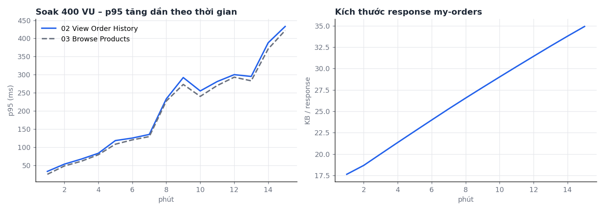

# 05 – GitHub Issues (Người 5 – Workflow 5)

> Đã đăng tại https://github.com/KTPM2026/HW5/issues (#2–#7). **Phần "Mô tả" do sinh viên tự viết** (AI Agreement §11); phần bằng chứng bên dưới là số liệu thu thập từ JMeter/curl/mã nguồn. Ảnh trang Issues: `evidence/github_issues/`.

---

## Issue #2 – [P5][Perf] GET /api/orders/my-orders chậm dần theo số đơn (full table scan, không phân trang)

**Người báo:** Thành viên 5 (23120317) – Workflow 5 · **Loại:** Performance

#### Mô tả
API này trả về toàn bộ đơn, trong khi chỉ cần một số ít đơn, không có phân trang. Toàn bộ đơn được truy vấn làm tăng độ trễ và kích thước response.

---
*Phần dưới: bằng chứng / số liệu tái hiện (thu thập từ lần chạy JMeter, curl và mã nguồn).*

#### Bằng chứng (Soak 400 VU, 15 phút, 0% lỗi)


- p95 toàn hệ thống theo phút: **47 ms → 393 ms**; RPS 599 → 494 (−17%)
- Response my-orders: **~18 KB → ~35 KB** (bảng orders 56.984 → 117.431 dòng)
- `Browse Products` (bảng chỉ 5 dòng) chậm y hệt → nghẽn do hàng đợi DB dùng chung
- Đo trên bản sao DB 117.431 đơn ([bench_index.md](../results/optimization/bench_index.md)): **10,68 ms/truy vấn**

#### Tái hiện
Chạy `test-plans/23120317_Soak_20261119.jmx` 15 phút, so sánh p95 phút đầu và phút cuối ([analysis.md](../results/23120317_Soak_20261119/analysis.md)).

#### Đề xuất (đã đo trên bản sao DB)
| Biến thể | ms/truy vấn |
|---|---:|
| Hiện tại | 10,68 |
| `CREATE INDEX idx_orders_user_id ON orders(user_id, id DESC)` | 1,20 (8,9×) |
| Index + `LIMIT 20` | **0,18 (59×)** |


---

## Issue #3 – [P5][Bug] Giỏ hàng không bị xóa sau checkout, tăng vô hạn trong RAM

**Người báo:** Thành viên 5 (23120317) – Workflow 5 · **Loại:** Bug + Performance

#### Mô tả
Sau khi thanh toán thành công, các sản phẩm vẫn còn trong giỏ hàng khi gọi GET /api/cart, thay vì được xóa như yêu cầu FR-08. Ngoài ra, khi thêm một sản phẩm đã tồn tại, hệ thống tạo dòng dữ liệu mới thay vì tăng số lượng sản phẩm theo FR-07. Điều này khiến dữ liệu giỏ hàng bị trùng lặp, dung lượng response tăng dần và tiêu tốn RAM của server theo thời gian.

---
*Phần dưới: bằng chứng / số liệu tái hiện (thu thập từ lần chạy JMeter, curl và mã nguồn).*

#### Tái hiện
1. Login → `POST /api/cart` → `POST /api/checkout` → `GET /api/cart`
2. **Mong đợi:** `[]` · **Thực tế:** vẫn còn sản phẩm đã thanh toán

#### Bằng chứng
Soak 15 phút: kích thước response `GET /api/cart` **8,8 KB → 15,6 KB**; RAM process node 109 → 127 MB ([analysis.md](../results/23120317_Soak_20261119/analysis.md)).

#### Đề xuất
Xóa giỏ sau checkout thành công; gộp sản phẩm trùng; lưu giỏ vào DB (bắt buộc nếu chạy nhiều worker/cluster).


---

## Issue #4 – [P5][Bug] Khóa tài khoản sai đặc tả FR-02: khóa sau 2 lần sai, khóa 180 giây

**Người báo:** Thành viên 5 (23120317) · **Loại:** Functional bug (FR-02)

#### Mô tả
Logic đếm số lần đăng nhập sai đang tăng bộ đếm thêm 2 thay vì 1 sau mỗi lần thử. Đồng thời, thời gian khóa tài khoản là 180 giây thay vì 30 giây như đặc tả FR-02. Điều này khiến tài khoản bị khóa sớm hơn dự kiến, gây bất tiện cho người dùng và không tuân thủ yêu cầu nghiệp vụ.

---
*Phần dưới: bằng chứng / số liệu tái hiện (thu thập từ lần chạy JMeter, curl và mã nguồn).*

#### Đặc tả FR-02
Mỗi lần đăng nhập sai tăng bộ đếm **+1**; khóa khi sai **≥ 3** lần liên tiếp; khóa **30 giây**.

#### Thực tế (`backend/server.js`)
```js
const newAttempts = user.login_attempts + 2;          // +2 thay vì +1
if (newAttempts >= 3) lockedUntil = Date.now() + 180000; // 180 s thay vì 30 s
```

#### Tái hiện
```bash
for i in 1 2 3; do curl -s -w " [%{http_code}]\n" -H 'Content-Type: application/json' \
  -d '{"email":"test@eshop.com","password":"wrong"}' localhost:3000/api/login; done
```
```
{"error":"Invalid email or password"} [401]
{"error":"Invalid email or password"} [401]
{"error":"Tài khoản đã bị khóa. Vui lòng thử lại sau."} [403]
```
→ Bị khóa ngay sau **2** lần sai, và khóa 3 phút.

#### Ảnh hưởng tới kiểm thử hiệu năng
Chỉ 2 request sai (vd. 1 dòng CSV hỏng) là account bị khóa 3 phút → mọi VU dùng account đó nhận 403. Test plan dùng credential hợp lệ + script `reset_lockout.js` giữa các lần chạy.


---

## Issue #5 – [P5][Perf] Server từ chối kết nối khi vượt ~1.100 người dùng đồng thời

**Người báo:** Thành viên 5 (23120317) – Workflow 5 · **Loại:** Performance

#### Mô tả
Khi số lượng người dùng đồng thời tăng lên khoảng 1.100, server bắt đầu từ chối kết nối và tỷ lệ request thất bại tăng đột biến. Throughput đã bão hòa ở khoảng 900–950 RPS trước khi lượng request thành công sụt giảm mạnh. Điều này cho thấy hệ thống có giới hạn về khả năng xử lý tải đồng thời, làm giảm nghiêm trọng khả năng phục vụ khi lưu lượng tăng cao, dù server vẫn có thể tự phục hồi sau khi giảm tải.

---
*Phần dưới: bằng chứng / số liệu tái hiện (thu thập từ lần chạy JMeter, curl và mã nguồn).*

#### Phân loại lỗi (từ .jtl)
| Lỗi | Số lượng |
|---|---:|
| `HttpHostConnectException` (connection refused) | 534.586 |
| `java.net.BindException` (máy tải hết cổng tạm – giới hạn phía JMeter chạy chung máy) | 3.999 |
| `SocketTimeoutException` (> 30 s) | 198 |

99,9% lỗi rơi vào `01 Login` – bước duy nhất mở kết nối TCP mới mỗi vòng. Server **không crash**, tự hồi phục sau khi rút tải. Không có tài khoản bị khóa.

#### Dữ liệu
[analysis.md](../results/23120317_Stress_20261119_breakpoint/analysis.md) · `html-report/` cùng thư mục

#### Đề xuất
Load shedding (503 khi event-loop lag cao), tăng backlog `app.listen(PORT, host, 2048)`, giảm chi phí mỗi request (issue về my-orders), cân nhắc cluster sau khi chuyển giỏ hàng ra khỏi RAM.


---

## Issue #6 – [P5][Security] GET /api/orders/:id không yêu cầu xác thực (IDOR)

**Người báo:** Thành viên 5 (23120317) · **Loại:** Security (IDOR)

#### Mô tả
API cho phép truy xuất thông tin đơn hàng chỉ bằng ID mà không yêu cầu xác thực hoặc kiểm tra quyền sở hữu đơn hàng. Người không đăng nhập có thể xem dữ liệu nhạy cảm của người khác như user ID, tổng tiền và địa chỉ giao hàng. Đây là lỗ hổng bảo mật nghiêm trọng, có thể dẫn đến rò rỉ thông tin cá nhân và dữ liệu giao dịch của khách hàng.

---
*Phần dưới: bằng chứng / số liệu tái hiện (thu thập từ lần chạy JMeter, curl và mã nguồn).*

#### Tái hiện
```bash
curl -s localhost:3000/api/orders/1550      # không gửi header Authorization
```
```json
{"id":1550,"user_id":51,"total_amount":4000000,"status":"pending","shipping_address":"49 Le Loi Q1 TP.HCM","created_at":"2026-11-19 16:02:53"}
```

#### Mong đợi
401 khi không có token; 403/404 khi đơn không thuộc user đang đăng nhập.


---

## Issue #7 – [P5][Security] POST /api/login trả về mật khẩu plaintext trong response

**Người báo:** Thành viên 5 (23120317) · **Loại:** Security

#### Mô tả
Sau khi đăng nhập thành công, API trả về toàn bộ bản ghi người dùng, bao gồm cả trường password chứa mật khẩu dạng plaintext. Điều này khiến thông tin xác thực bị lộ ngay trong response và có thể bị khai thác nếu dữ liệu được lưu trong log, cache hoặc bị các bên không có quyền truy cập. API cần loại bỏ hoàn toàn trường mật khẩu khỏi response trả về cho client.

---
*Phần dưới: bằng chứng / số liệu tái hiện (thu thập từ lần chạy JMeter, curl và mã nguồn).*

#### Tái hiện
```bash
curl -s -H 'Content-Type: application/json' -d '{"email":"test@eshop.com","password":"Test1234!"}' localhost:3000/api/login
```
```json
{"message":"Login successful","token":"eyJ...","user":{"id":2,"name":"Test User","email":"test@eshop.com","password":"Test1234!","role":"user","login_attempts":0, ...}}
```

#### Mong đợi
Chỉ trả `id, name, email, role`; mật khẩu phải được băm (bcrypt) và không bao giờ gửi về client.

> Phát hiện trong Task 2 (AI phân tích), đã kiểm chứng thủ công.

