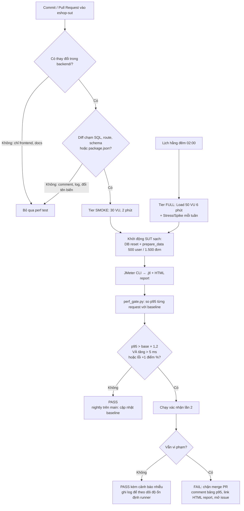
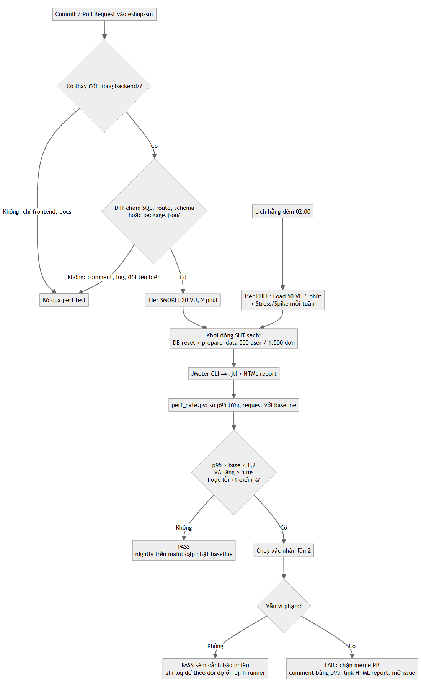

# 06 – Task 3: Đề xuất Continuous Performance Testing (G9.6 – Disrupt)

> Mục tiêu: theo dõi các commit của SUT, **tự quyết định có cần chạy performance test hay không**, và **cảnh báo khi p95 bị hồi quy** – không phụ thuộc người nhớ chạy JMeter bằng tay.
> Hiện thực kèm theo: `scripts/perf_gate.py` (cổng hồi quy, đã chạy thử trên số liệu thật), `ci/perf-regression.yml` (GitHub Actions mẫu), `ci/baseline.json` (baseline từ lần Load chính thức 22/11).

## 1. Lưu đồ

> Bản ảnh của lưu đồ (dùng khi trình xem không render Mermaid): 

## 2. Thành phần

| Bước | Quyết định / cơ chế | Lý do (từ kết quả HW05) |
|---|---|---|
| **Lọc thay đổi** | Chỉ `backend/**`; tiếp tục lọc theo diff có chứa `db.run/get/all`, `SELECT/INSERT/UPDATE/CREATE`, route `app.get/post…`, hoặc `package.json` | Các vấn đề tìm được đều nằm ở truy vấn SQL (scan `orders`), route (giỏ hàng) và cấu hình DB. Thay đổi frontend không ảnh hưởng API |
| **Phân tầng** | *Smoke* (PR): 30 VU × 2 phút ≈ 3–4 phút CI. *Full* (đêm): Load 6 phút; Stress/Spike hằng tuần | Đánh đổi chi phí runner và tốc độ phản hồi cho dev |
| **Môi trường xác định** | Mỗi lần chạy: start server (DB tự DROP/seed) + `prepare_data.js` → luôn **1.500 đơn, 500 user**; reset lockout | Bài học M1 ở Task 2: so sánh các lần chạy với kích thước bảng `orders` khác nhau (1.500 so với 56.000) cho kết luận sai |
| **Chỉ số so sánh** | p95 **theo từng request label**, error % | p95 tổng che mất hồi quy cục bộ (vd. chỉ Order History chậm đi) |
| **Ngưỡng** | REGRESSION khi **p95 > baseline × 1,2 VÀ tăng > 5 ms**, hoặc error % tăng > 1 điểm | Xem §3 – chỉ dùng % sẽ báo động giả hàng loạt vì baseline chỉ 2–7 ms |
| **Xác nhận** | Fail lần 1 → chạy lại; chỉ fail khi 2 lần liên tiếp vi phạm | Giảm báo động giả do runner dùng chung (CPU "hàng xóm") |
| **Baseline** | Cập nhật từ lần nightly PASS trên `main` (có thể dùng trung vị 5 lần gần nhất) | Tránh "trôi baseline" do PR chậm dần từng chút được chấp nhận |
| **Kết quả** | Bảng p95 vào `GITHUB_STEP_SUMMARY` + comment PR, artifact `.jtl` + HTML report, chặn merge khi FAIL | Dev thấy ngay request nào chậm và bao nhiêu |

## 3. Kiểm chứng cổng `perf_gate.py` trên số liệu thật

Baseline = Load chính thức 22/11 (`ci/baseline.json`, p95 từng request 2–7 ms).

| Trường hợp | Ý nghĩa | Kết quả cổng |
|---|---|---|
| A. Load so với chính nó | Không có thay đổi | **PASS**, 0/8 vi phạm |
| B. Soak (bảng 57–117 nghìn đơn, 400 VU) | Mô phỏng hồi quy thật (p95 tăng 90–277 ms) | **REGRESSION**, 8/8 vi phạm, exit 1 |
| C. Spike (cùng code, tải ngắn đột biến) | Nhiễu: p95 tăng 1–5 ms | **PASS** – 6 label được đánh dấu "⚠️ tăng nhưng trong ngưỡng nhiễu" |
| D. Spike, chỉ dùng ngưỡng tương đối (`--abs 0`) | Cổng ngây thơ "+20%" | **REGRESSION giả** ở 6/8 label |

→ Trường hợp D cho thấy định lượng rủi ro báo động giả: với p95 nền 2–4 ms, chỉ cần +1 ms (dao động bình thường) là đã vượt 20%. **Sàn tuyệt đối 5 ms** loại bỏ toàn bộ báo động giả ở C nhưng vẫn bắt được B.

Hạn chế đã biết: `02 View Order History` ở C tăng đúng +5 ms (ngưỡng biên). Cần thêm dữ liệu nhiều lần chạy để hiệu chỉnh sàn nhiễu theo độ lệch chuẩn thực tế của runner (vd. ngưỡng = max(5 ms, 3σ)).

## 4. Thảo luận đánh đổi

### Chi phí
| Mục | Ước tính |
|---|---|
| Smoke trên PR | ~4–6 phút runner (cài JMeter + seed 500 user ~10 s + chạy 2 phút) – chỉ khi diff chạm backend |
| Nightly full | ~10 phút/đêm ≈ 5 giờ runner/tháng – trong hạn mức miễn phí của repo public |
| Stress/Spike hằng tuần | ~15 phút; **không** chạy trên PR vì đẩy runner tới bão hòa, kết quả rất nhiễu |
| Chi phí ẩn | Bảo trì test plan khi API đổi, lưu artifact `.jtl` (vài MB/lần) |

Lọc theo diff tiết kiệm phần lớn chi phí: nhiều commit chỉ chạm frontend/docs không kích hoạt perf test.

### Báo động giả (false positive) và bỏ sót (false negative)
- **Runner dùng chung** (GitHub-hosted) có CPU dao động → p95 nhiễu; giảm bằng ngưỡng kép + chạy xác nhận + so sánh theo từng label với cùng dữ liệu seed.
- **Baseline quá nhỏ** (vài ms) làm ngưỡng % vô nghĩa (đã chứng minh ở §3-D).
- **Bỏ sót:** smoke 30 VU / 1.500 đơn **không** bắt được lỗi chỉ lộ ra khi dữ liệu lớn hoặc tải cao, như full scan `orders` chỉ rõ ở >50 nghìn đơn, hoặc connection refused ở >1.000 VU. Bù lại bằng nightly có **seed lớn** (vd. 100 nghìn đơn) và stress hằng tuần.
- **Bỏ qua theo diff** có thể sót thay đổi gián tiếp (vd. nâng version `sqlite3` qua lockfile) → luôn chạy khi `package-lock.json` đổi; nightly vẫn chạy bất kể diff.

### Rủi ro khác
- Nightly tự cập nhật baseline có thể "hợp thức hóa" suy giảm chậm → giới hạn mỗi lần cập nhật không được tăng quá 10% so với baseline cũ, nếu vượt phải có người duyệt.
- Môi trường CI khác máy dev (Linux so với Windows, ít core hơn) → baseline phải lấy **trên chính runner CI**, không dùng số đo laptop (baseline trong repo hiện là số laptop VICTUS16 – chỉ để minh họa).

## 5. Lộ trình áp dụng
1. Đưa `test-plans/`, `scripts/`, `ci/` vào thư mục `perf/` của repo SUT; chép `ci/perf-regression.yml` vào `.github/workflows/`.
2. Chạy nightly 1 tuần **chỉ báo cáo, không chặn merge** để đo nhiễu thực tế của runner → hiệu chỉnh `--rel/--abs`.
3. Bật chặn merge cho PR khi tỷ lệ báo động giả đo được < 5%.
4. Bổ sung seed lớn cho nightly và theo dõi xu hướng p95 theo commit.
